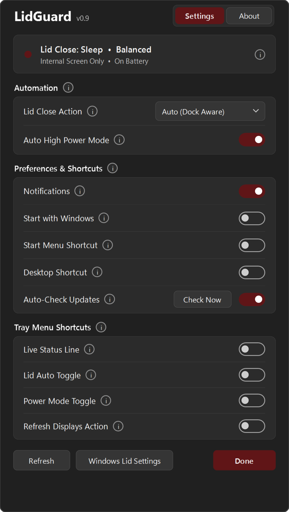
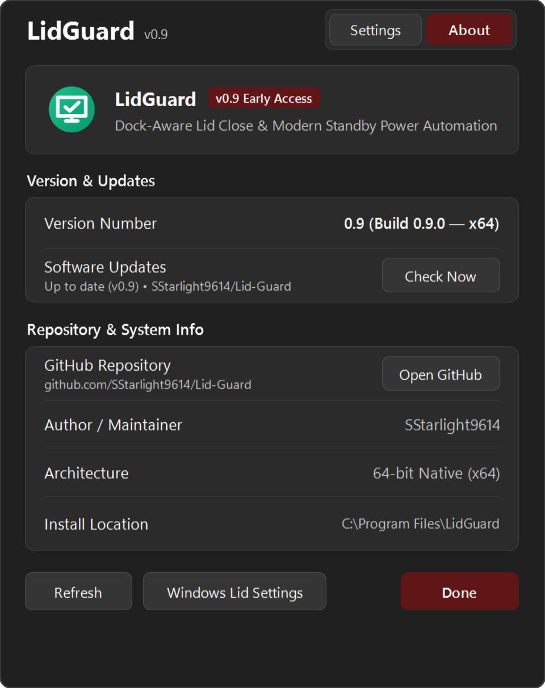
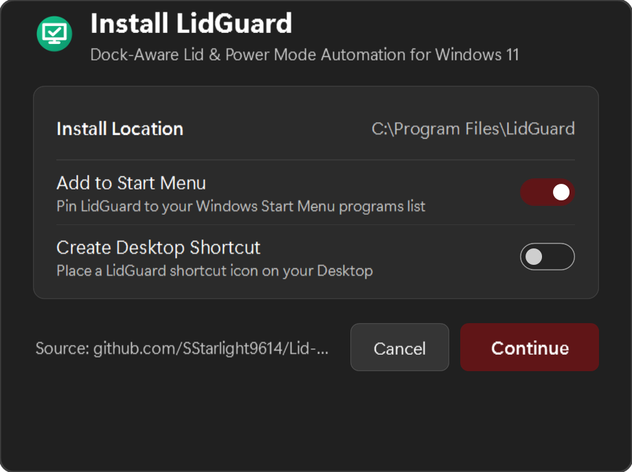

# LidGuard

A lightweight, native 64-bit Windows 11 system tray utility with a Fluent Design & real DWM Mica WPF interface that automatically prevents your laptop from sleeping when docked to an external monitor and switches Windows Modern Standby power modes.

[](https://github.com/SStarlight9614/Lid-Guard/releases/latest)
[](LICENSE)
[-0078D4)](https://github.com/SStarlight9614/Lid-Guard)

---

## 📸 Screenshots

| Settings Tab (Fluent Mica UI) | About Tab (`v0.9 Early Access`) |
| :---: | :---: |
|  |  |

<p align="center">
  
  <br/>
  <em>Standalone One-Click GitHub Installer (<code>LidGuardInstaller.exe</code>)</em>
</p>

---

## ✨ Highlighted Features

- **Dock-Aware Lid Close Automation (`QueryDisplayConfig`)**:
  - **External Display Connected**: Automatically sets your Plugged-In Lid Close Action to **Do Nothing** so you can close your laptop lid in clamshell mode without turning off your external monitor.
  - **Internal Screen Only**: Automatically restores Plugged-In Lid Close Action to **Sleep** the moment you undock so your laptop sleeps safely in your bag.
- **Automatic Modern Standby High Power Mode (`powrprof.dll`)**:
  - Seamlessly switches the Windows 11 Modern Standby power overlay (`PowerSetActiveOverlayScheme`) to **Best Performance** when plugged into AC power and connected to an external display.
  - Automatically reverts to **Balanced** when undocked or running on battery.
- **Native Windows 11 Fluent Design & Real Mica UI**:
  - Uses real DWM Mica (`DWMWA_SYSTEMBACKDROP_TYPE = 2`) with automatic **System Dark & Light Theme** switching, **Windows System Accent Color** integration (on buttons, toggles, and optional titlebar accent), solid `#2B2B2B` / `#FBFBFB` cards, and crisp subpixel **ClearType** text rendering.
- **Clean System Tray & Hover Info Badges (`i`)**:
  - Minimal right-click system tray menu (**Open Settings** and **Exit** by default) with customizable toggles in Settings to optionally surface **Live Status Line**, **Lid Auto Toggle**, **Power Mode Toggle**, and **Refresh Displays Action**.
  - Compact hover info badges (`i`) provide detailed descriptions without cluttering the interface.
- **Separated One-Click Installer (`LidGuardInstaller.exe`)**:
  - Downloaded from [GitHub Releases](https://github.com/SStarlight9614/Lid-Guard/releases/latest); fetches the application files from this repository and installs to `C:\Program Files\LidGuard` (for 64-bit) or `C:\Program Files (x86)\LidGuard` (for 32-bit).
  - Prompts for **Add to Start Menu** (checked by default) and **Create Desktop Shortcut**, then automatically launches **LidGuard** and closes the installer.
- **Release-Only GitHub Auto-Updater**:
  - Built-in update checker (available in both the **Settings** and **About** tabs) queries **GitHub Releases** (`SStarlight9614/Lid-Guard/releases/latest`)—**not** raw intermediate commits on `main`—so users only receive official, manually published releases.

---

## 📦 Installation

1. Go to the [**Latest Release**](https://github.com/SStarlight9614/Lid-Guard/releases/latest) page and download **`LidGuardInstaller.exe`**.
2. Run **`LidGuardInstaller.exe`**, choose your shortcut options (**Add to Start Menu** is enabled by default), and click **Continue**.
3. **LidGuard** will be installed into `C:\Program Files\LidGuard` and will launch automatically into your Windows 11 system tray.

---

## 🛠️ Building from Source

No external SDK installation is required—both `LidGuard.exe` and `LidGuardInstaller.exe` compile directly using the built-in Windows .NET Framework 4.8 64-bit compiler (`csc.exe`):

```powershell
powershell -ExecutionPolicy Bypass -File .\build.ps1
```

*(Note: `*.exe` build outputs are excluded via `.gitignore` so source commits stay clean; compiled installer binaries are published manually via [GitHub Releases](https://github.com/SStarlight9614/Lid-Guard/releases).)*

---

## 📄 License & Attribution

Licensed under the [**MIT License**](LICENSE) — Copyright © 2026 [**SStarlight9614**](https://github.com/SStarlight9614).  
You are free to fork, modify, and distribute this work provided that credit and the copyright notice to **SStarlight9614** are retained in all copies or forks.
